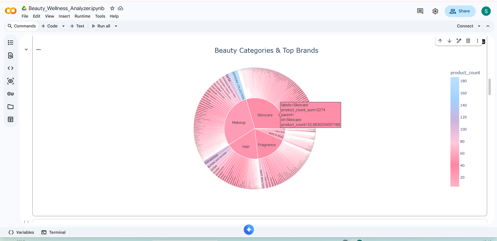
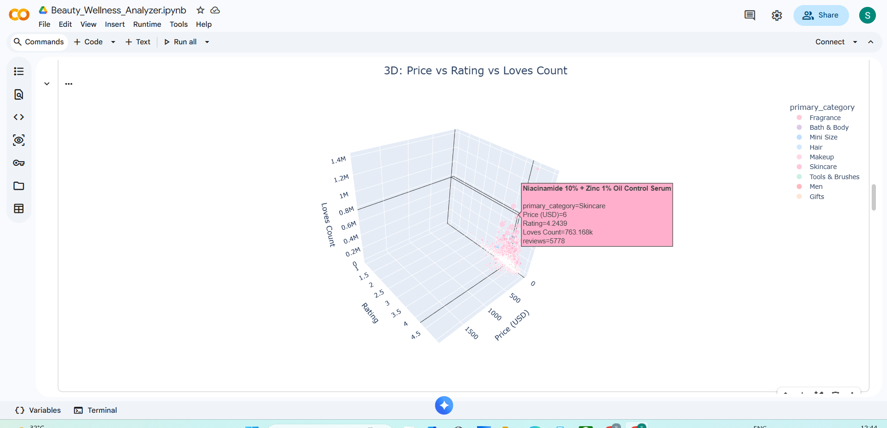
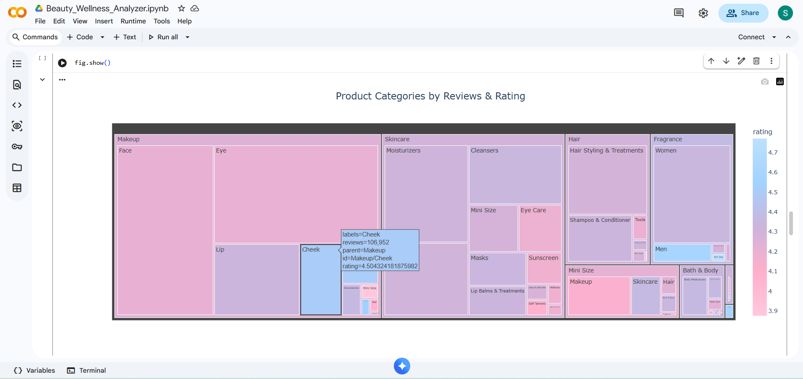
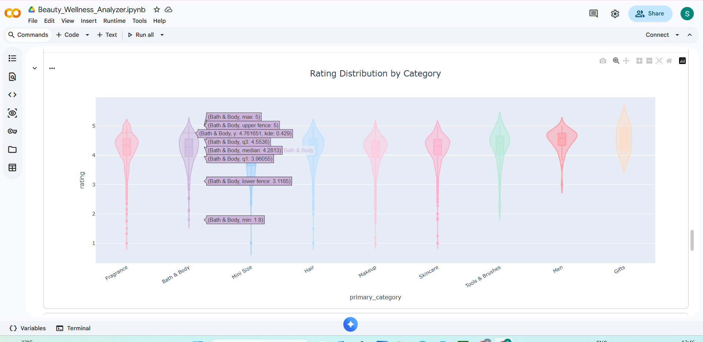
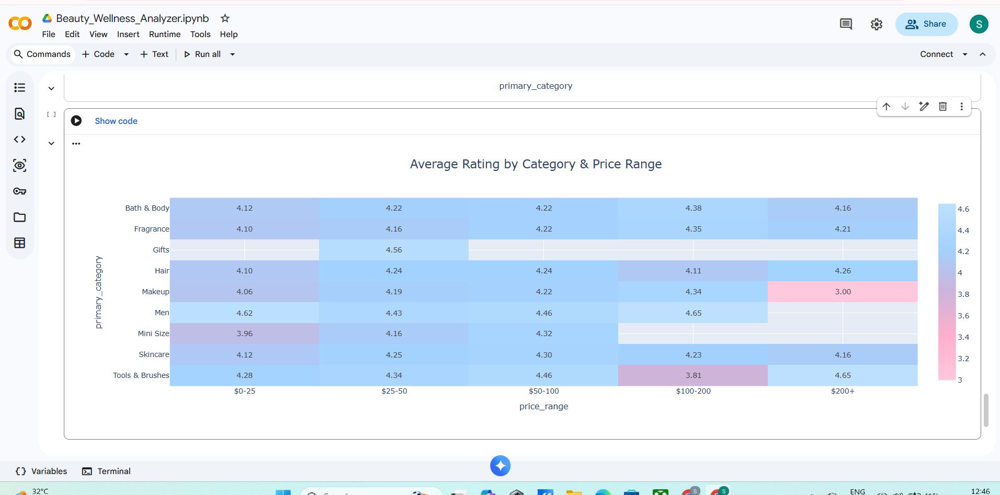
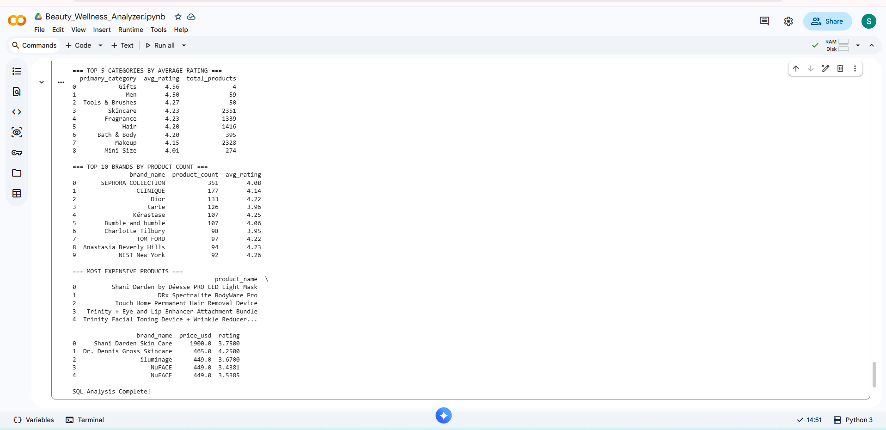

# 💄 Beauty & Wellness Industry Analyzer

Analyzed 8,216 Sephora products across 9 categories to identify 
brand performance and rating patterns. Men's products rate highest 
at the $0–25 price point (4.62 avg); premium Makeup above $200 
underperforms at 3.0 avg rating.

## Dataset
- **Source:** Kaggle — Sephora Products and Skincare Reviews
- **Size:** 8,216 products across 9 categories
- **Price Range:** $3 to $1,900

## Tools & Libraries
`Python` | `Pandas` | `NumPy` | `Plotly` | `SQLite` | `Google Colab`

---

## Visualizations

### 1. Brand Hierarchy by Category
*Sunburst Chart — brand dominance within each category*

### 2. Price vs Rating vs Loves Count
*3D Bubble Chart — multi-dimensional product engagement*

### 3. Product Distribution
*Treemap — breakdown by sub-category*

### 4. Rating Distribution by Category
*Violin Plot — rating spread across all 9 categories*

### 5. Category vs Price Range Ratings
*Heatmap — average rating by category and price band*

### 6. SQL Aggregate Analysis
*SQLite queries — top categories, brands, and products by rating*

---

## Key Insights
- **Men's category** has the highest average rating (4.62) 
  in the $0–25 price range, the highest of any category-price 
  combination.
- **Premium Makeup ($200+)** averages only 3.0 — the lowest 
  rating in the dataset.
- **Skincare and Makeup** together account for the majority 
  of products; Skincare leads in sub-category variety.
- **Tools & Brushes** show the most consistent ratings 
  across all price ranges.
- **SEPHORA COLLECTION** has the most products (351), 
  followed by CLINIQUE (177) and Dior (133).
