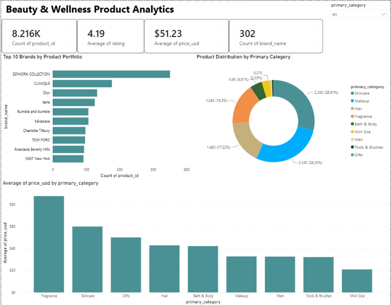

# 💄 Beauty & Wellness Industry Analyzer

Analyzed 8,216 Sephora products across 9 categories to identify brand performance and rating patterns. Men's products have the highest average rating (4.50 across 59 products) among categories with 50+ products, while Mini Size has the lowest (4.01 across 274 products).

## Dataset
- **Source:** Kaggle - Sephora Products and Skincare Reviews
- **Size:** 8,216 products across 9 categories
- **Price range:** 3 to 1,900 USD

## Tools & Libraries
`Python` | `Pandas` | `NumPy` | `Plotly` | `SQLite` | `Power BI` | `Google Colab`

---

## Visualizations

### 1. Brand Hierarchy by Category
*Sunburst chart: brands within each category*

### 2. Price vs Rating vs Loves Count
*3D bubble chart: product engagement across price and rating*

### 3. Product Distribution
*Treemap: breakdown by sub-category*

### 4. Rating Distribution by Category
*Violin plot: rating spread across all 9 categories*

### 5. Category vs Price Range Ratings
*Heatmap: average rating by category and price band*

### 6. SQL Aggregate Analysis
*SQLite queries: categories, brands and most expensive products*

### 7. Power BI Dashboard
*KPI cards, top 10 brands, category distribution, and average price by category with a category slicer*

---

## Key Insights
- **Men's category** has the highest average rating (4.50, 59 products) among categories with 50+ products; **Mini Size** has the lowest (4.01, 274 products).
- Within Men's, products priced 0-25 USD average 4.62 (22 products).
- **Makeup and Skincare** are the largest categories by product count (2,328 and 2,351 products).
- **SEPHORA COLLECTION** has the most products (351), followed by CLINIQUE (177) and Dior (133).

**Note:** The Makeup 200+ USD cell in the heatmap (3.00 average) is based on only 2 products, so it should not be read as a trend. The Gifts category (4.56 average) has only 4 products.
